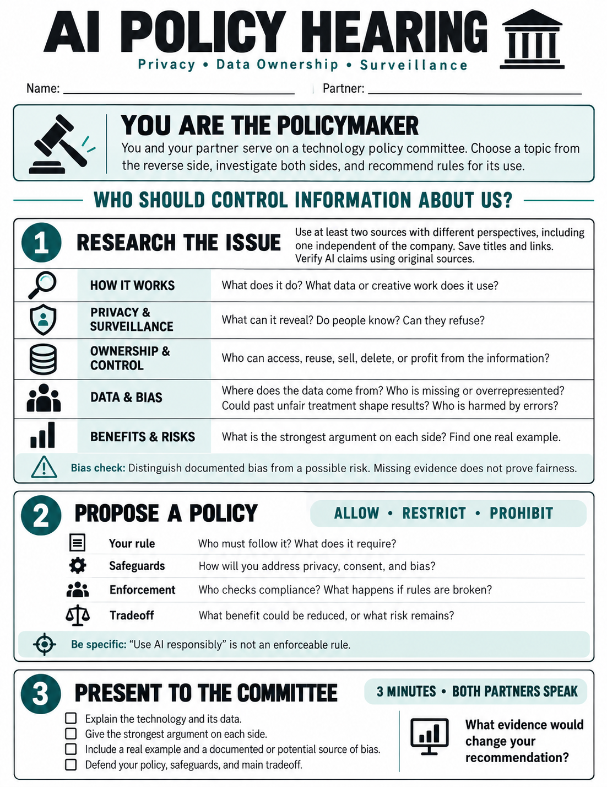

<h2>Choose Your Policy Debate</h2>

    These arguments are starting points to investigate—not conclusions to accept.

<table style="width: 100%; border-collapse: collapse; font-family: Arial, sans-serif; font-size: 1rem; line-height: 1.4; color: #183237; border: 1px solid #b9cdce;">
    <thead>
        <tr style="background-color: #075c63; color: white; text-align: left;">
            <th scope="col" style="padding: 12px; width: 19%;">Topic</th>
            <th scope="col" style="padding: 12px; width: 29%;">Central Policy Question</th>
            <th scope="col" style="padding: 12px; width: 26%;">Arguments For</th>
            <th scope="col" style="padding: 12px; width: 26%;">Arguments Against</th>
        </tr>
    </thead>
    <tbody>
        <tr style="background-color: #edf6f5; border-bottom: 1px solid #b9cdce; vertical-align: top;">
            <th scope="row" style="padding: 12px; text-align: left;">1. Flock Cameras &amp; License Plate Tracking</th>
            <td style="padding: 12px;">Should towns keep searchable records of vehicles on public roads?</td>
            <td style="padding: 12px;">Investigate crimes, recover stolen vehicles, and find missing people.</td>
            <td style="padding: 12px;">Track innocent people, enable misuse, and expand data sharing.</td>
        </tr>
        <tr style="border-bottom: 1px solid #b9cdce; vertical-align: top;">
            <th scope="row" style="padding: 12px; text-align: left;">2. Smart Glasses &amp; Wearables</th>
            <td style="padding: 12px;">Should AI devices record and analyze bystanders without permission?</td>
            <td style="padding: 12px;">Improve accessibility, translation, navigation, and documentation.</td>
            <td style="padding: 12px;">Record people without consent; expose identities, conversations, and routines.</td>
        </tr>
        <tr style="background-color: #edf6f5; border-bottom: 1px solid #b9cdce; vertical-align: top;">
            <th scope="row" style="padding: 12px; text-align: left;">3. AI Hiring &amp; Résumé Scanners</th>
            <td style="padding: 12px;">Should AI screen, rank, or reject job applicants?</td>
            <td style="padding: 12px;">Process applications quickly and identify relevant skills.</td>
            <td style="padding: 12px;">Reinforce bias, make hidden judgments, and limit applicants’ ability to appeal.</td>
        </tr>
        <tr style="border-bottom: 1px solid #b9cdce; vertical-align: top;">
            <th scope="row" style="padding: 12px; text-align: left;">4. Web Scraping &amp; Artist Rights</th>
            <td style="padding: 12px;">Should AI companies train on public artwork without permission or payment?</td>
            <td style="padding: 12px;">Support innovation and expand access to creative tools.</td>
            <td style="padding: 12px;">Reduce artists’ control and compensation; compete using their work.</td>
        </tr>
        <tr style="background-color: #edf6f5; border-bottom: 1px solid #b9cdce; vertical-align: top;">
            <th scope="row" style="padding: 12px; text-align: left;">5. Predictive Policing</th>
            <td style="padding: 12px;">Should AI predictions guide police patrols or investigations?</td>
            <td style="padding: 12px;">Identify patterns, direct resources, and potentially prevent crime.</td>
            <td style="padding: 12px;">Reinforce past policing patterns and concentrate surveillance.</td>
        </tr>
        <tr style="border-bottom: 1px solid #b9cdce; vertical-align: top;">
            <th scope="row" style="padding: 12px; text-align: left;">6. AI Monitoring in Schools</th>
            <td style="padding: 12px;">How much student activity should schools monitor?</td>
            <td style="padding: 12px;">Identify threats, support students in crisis, and protect networks.</td>
            <td style="padding: 12px;">Expose private information, discourage help-seeking, and monitor beyond school.</td>
        </tr>
        <tr style="background-color: #edf6f5; border-bottom: 1px solid #b9cdce; vertical-align: top;">
            <th scope="row" style="padding: 12px; text-align: left;">7. Health, Fitness &amp; Genetic Data</th>
            <td style="padding: 12px;">Should companies use or share health, fitness, and genetic data to develop AI?</td>
            <td style="padding: 12px;">Advance medical research, detect illness, and personalize care.</td>
            <td style="padding: 12px;">Expose sensitive information, enable discrimination, and affect relatives who never consented.</td>
        </tr>
        <tr style="vertical-align: top;">
            <th scope="row" style="padding: 12px; text-align: left;">8. Facial Recognition in Public</th>
            <td style="padding: 12px;">Should police or businesses identify people using public cameras?</td>
            <td style="padding: 12px;">Find missing people, investigate crimes, and identify threats.</td>
            <td style="padding: 12px;">Remove anonymity, track lawful activities, and misidentify people.</td>
        </tr>
    </tbody>
</table>

### Keep These Distinctions in Mind

- **License plate recognition identifies vehicles; facial recognition identifies people.**
- **Predictive policing can target places or individuals.** Specify which your policy addresses.
- **Public access does not automatically settle questions of permission or ownership.**
- **Accuracy does not settle privacy concerns.** Even a perfectly accurate system may collect information people should be able to keep private.